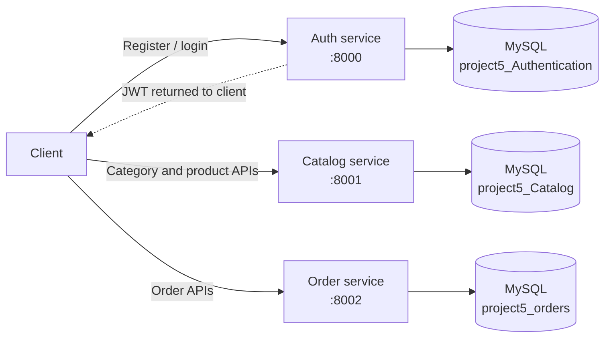

# Architecture

## Overview

The system is a collection of three standalone Spring Boot REST applications. Each application has its own controllers, service layer, repositories, JPA entities, and MySQL schema. Clients call each application directly; there is no API gateway or service registry.

The dotted JWT path represents the login response: the client receives a token. There is currently no configured token validation connection from the catalog or order services.

## Request and data flow

1. A client registers or logs in through `authservice`. The service stores users in its own database, BCrypt-hashes passwords, and returns a signed JWT on successful login.
2. A client manages categories and products through `catalogservice`. Products reference categories using a local JPA relationship in the catalog schema. List/search/filter operations use paginated repository queries.
3. A client submits order and item data directly to `orderservice`. The service stores a local order aggregate and computes totals from request-supplied prices. It does not retrieve product information or stock from the catalog.
4. Payment currently updates the order status locally; it does not contact a payment provider. Order status transitions are checked by the order service.

## Runtime and persistence

| Application | Default port | Default schema | Domain data |
|---|---:|---|---|
| Authentication | `8000` | `project5_Authentication` | Users and roles |
| Catalog | `8001` | `project5_Catalog` | Categories and products |
| Orders | `8002` | `project5_orders` | Orders and order items |

## Security model as implemented

- `authservice` uses stateless Spring Security and a JWT filter. Registration and login are public; the service's `/api/**` routes require the `USER` role.
- `catalogservice` has bearer-security annotations on its controllers for OpenAPI documentation, but no runtime Spring Security/JWT filter dependency is present.
- `orderservice` has no runtime authentication configuration.
- Consequently, JWT-based authentication is not currently end-to-end. The catalog and order endpoints should not be considered protected by the login token.

## Current limitations and integration seams

- No gateway, shared API client, inter-service HTTP calls.
- Orders store product identifiers and price snapshots without checking the catalog or inventory. The caller supplies unit prices and customer email.
