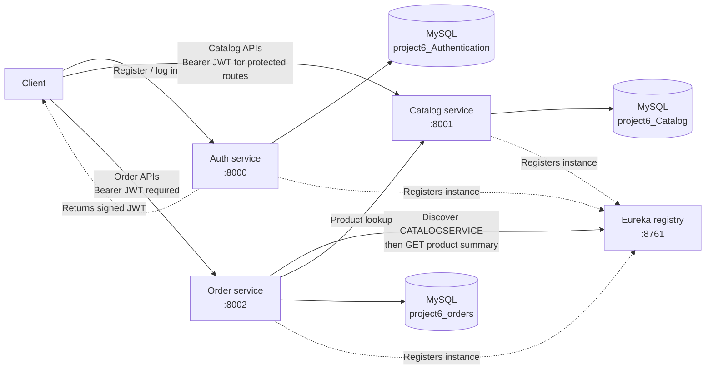

# Architecture

## Overview

This project is composed of four independently runnable Spring Boot applications: an authentication service, a catalog service, an order service, and a Eureka service registry. Each business service owns its API, domain model, and MySQL schema. The order service calls the catalog service to validate products and available quantity when creating an order; it discovers the catalog instance through Eureka and uses OpenFeign for the HTTP request.

The Eureka server runs on port `8761` and does not register with or fetch from another registry. All three business services register with it and fetch the registry. Eureka provides discovery only; the business data remains in each service's own database.

## Services and ownership

| Application | Default port | Default database | Responsibility |
|---|---:|---|---|
| `authservice` | `8000` | `project6_Authentication` | User registration, BCrypt password storage, login, and JWT issuance |
| `catalogservice` | `8001` | `project6_Catalog` | Categories and products, including search, filters, and pagination |
| `orderservice` | `8002` | `project6_orders` | Orders, order items, order status transitions, and payment placeholder |
| `eurekaserver` | `8761` | — | Service registration and discovery |

Each business service uses JPA with its own MySQL schema. Catalog products and categories are related within the catalog schema. Orders and order items are related within the order schema; order items keep a product ID and price snapshot, not a database relationship to catalog data. Database connection values and JWT settings are configured per service.

## Request and data flow

1. A client registers or logs in at the authentication service. On successful login, the service returns a signed JWT.
2. The client sends that bearer token to protected catalog and order routes. Those services validate tokens locally using their configured JWT signing key; they do not call the authentication service for each request.
3. When an order is created, `orderservice` calls `CatalogClientService`, which uses the OpenFeign `CatalogClient` registered under the Eureka service name `CATALOGSERVICE`. It requests the product summary, checks the requested quantity against the returned catalog quantity, and snapshots the catalog price in the order item.
4. The order service persists the order and items in its own schema. Catalog lookup is read-only: it does not reserve or decrement stock, so the availability check is a point-in-time check and does not prevent concurrent orders from overselling.
5. Payment is currently a local order status change from `CREATED` to `PAID`; no payment provider is called. Order status transitions are validated by the order service.

For catalog lookup failures, the order service configures Feign connect/read timeouts, Resilience4j retry, and a circuit breaker. Product-not-found and bad-request errors are treated separately from service availability failures; other exhausted/unavailable calls surface as a service-unavailable error.

## HTTP paths

All business applications set the servlet context path to `/api/v1`. Their controller mappings are appended to that prefix:

| Application | Effective paths |
|---|---|
| Authentication | `/api/v1/auth/register`, `/api/v1/auth/login` |
| Catalog | `/api/v1/api/categories...`, `/api/v1/api/products...` |
| Orders | `/api/v1/orders...` |

The order-to-catalog product lookup is `GET /api/v1/api/products/{id}/summary`. The catalog service permits that summary route without a JWT, allowing the Feign client to make the lookup without a token-forwarding configuration. Other catalog routes require an authenticated request, while Swagger/OpenAPI routes are public.

## Security boundaries

- `authservice` is stateless. `/auth/**` and its Swagger/OpenAPI routes are public; `/api/**` requires the `USER` role. It issues the JWTs accepted by the other services.
- `catalogservice` is stateless and validates JWTs with a local filter. The product summary route and Swagger/OpenAPI routes are public; other requests require authentication. The summary exception is the service-to-service lookup path.
- `orderservice` is stateless and requires authentication for all application routes. Swagger/OpenAPI routes are public. It validates JWTs locally and does not load user accounts from the authentication database.
- The services share JWT verification configuration so the order and catalog services can validate tokens issued by `authservice`. The signing key must be configured consistently across services.
- Customer email is supplied in the order request rather than derived from the authenticated identity. Authentication therefore does not, by itself, enforce ownership-based access to order records.

## Deployment and configuration notes

- The default ports are `8000` (authentication), `8001` (catalog), `8002` (orders), and `8761` (Eureka).
- MySQL defaults point to three separate local schemas named for project 6. Database credentials, JWT signing key, and service URLs/settings should be supplied through deployment configuration rather than relied on as production defaults.
- Service discovery is used for the order-to-catalog call; there is no API gateway, shared persistence schema, or separate centralized configuration service.
- Catalog prices are decimal values, while order item totals use integer fields and convert the catalog price during order creation. A shared currency and rounding convention should be defined before relying on monetary calculations in production.
